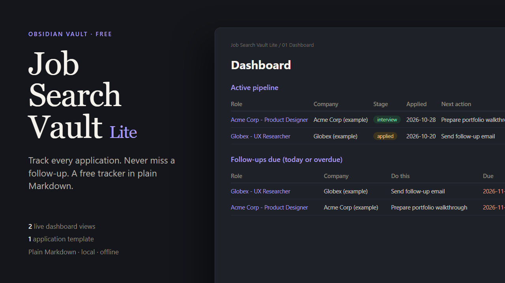
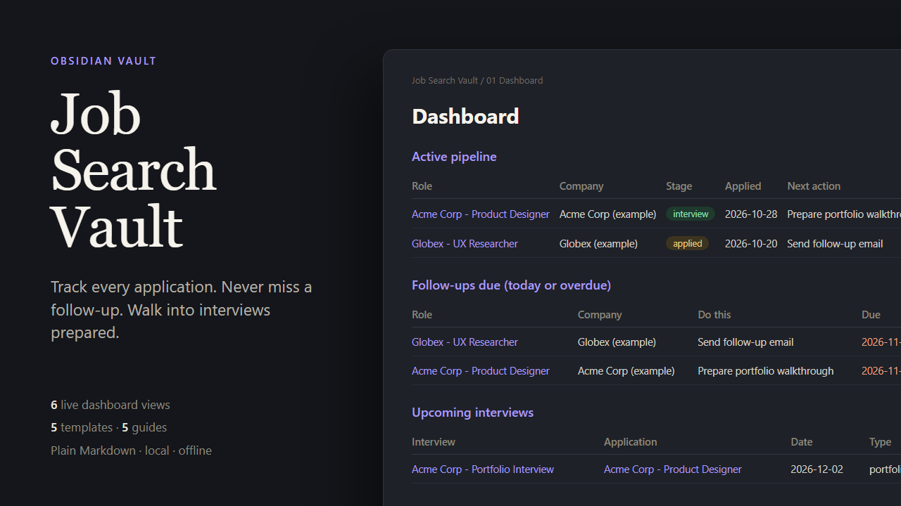

# Job Search Vault Lite – a free job application tracker for Obsidian

Track every job application in plain Markdown: a live **pipeline dashboard**, an **application template** and a list of **follow-ups that are due**, so no application is forgotten.

- 100 % local Markdown: no account, no cloud, works offline
- Uses the free [Dataview](https://github.com/blacksmithgu/obsidian-dataview) plugin and Obsidian's core Templates plugin
- Status workflow: `wishlist → applied → screening → interview → offer / rejected / ghosted`

## Quick start
1. Download the [Lite ZIP](https://github.com/webdesignthinkahead-gif/obsidian-job-search-vault/releases/latest), unzip it and open the folder in Obsidian (**Open folder as vault**).
2. Install and enable the community plugin **Dataview**.
3. Enable the core plugin **Templates**: template folder `Templates`, date format `YYYY-MM-DD`.
4. Open `01 Dashboard.md`.

## Full version
The full **Job Search Vault** adds:
- Dashboard views: upcoming interviews, stage counts, ghosting check, and which sources actually get responses
- Templates for interviews, contacts, STAR stories and weekly reviews
- 5 practical guides: follow-up email scripts, interview question bank, salary negotiation playbook, resume bullet formulas and a 30-day job search plan

→ **[Get the full Job Search Vault on Gumroad ($12)](https://kopsch.gumroad.com/l/job-search-vault)**

## License
Free to use and adapt for personal use. Created with the help of an AI assistant.
